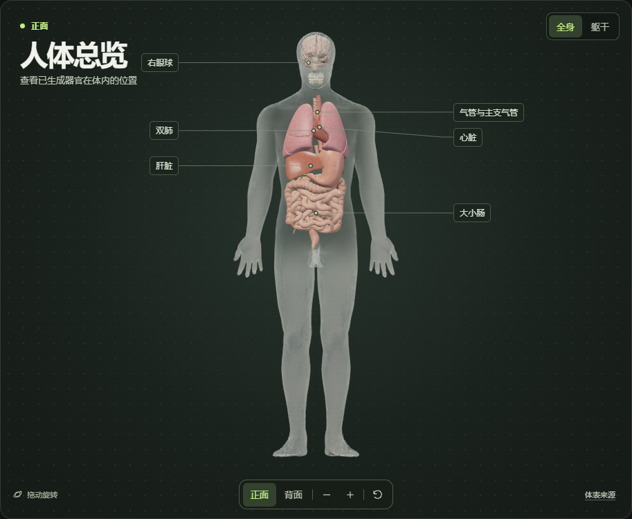

# Organ Atlas · 人体器官图谱

**[在线查看三维人体图谱](https://rikka314.github.io/organ-atlas/)**

图谱收录了 13 件由 Agent 操作 Blender 生成的人体解剖模型。你可以先在人体上找到器官，再进入「单独观察」，旋转模型，逐层查看内部结构。模型库会持续更新，加入新的器官和已有模型的修订版。

[](https://rikka314.github.io/organ-atlas/)

## 器官观察

在人体总览中拖动可以旋转，滚轮或双指可以缩放。进入单件模型后，可以隐藏选中的结构，或将它切换为线框。下面几个视角可以直接打开。

| 模型 | 可以看到什么 |
| --- | --- |
| 心脏 | 打开「显露心瓣膜」，从瓣叶沿腱索找到乳头肌，再看它与心室壁相连的位置。[左心室](https://rikka314.github.io/organ-atlas/?organ=heart&view=left-chain) · [右心室](https://rikka314.github.io/organ-atlas/?organ=heart&view=right-chain) |
| 双肺 | 隐藏肺叶后，可以沿支气管和血管查看它们在肺内的分支。[查看肺内结构](https://rikka314.github.io/organ-atlas/?organ=lungs&view=interior) |
| 成人脑 | 从顶部看左右大脑半球之间的纵裂，再转到前下方观察脑桥和延髓。[顶面](https://rikka314.github.io/organ-atlas/?organ=brain&view=superior) · [前下方](https://rikka314.github.io/organ-atlas/?organ=brain&view=ventral-oblique) |
| 脾脏 | 在切面上对照边缘的薄被膜和内部的红髓。[查看切面](https://rikka314.github.io/organ-atlas/?organ=spleen&view=interior) |
| 右眼 | 旋转眼球，观察透明角膜下的虹膜。[查看右眼](https://rikka314.github.io/organ-atlas/?organ=eye) |

图谱还收录了气管与主支气管、肝脏、胃、食管、大小肠、左肾、胰腺和上下恒牙列。模型颜色用于教学示意。各模型的展示范围和仍待核实的细节见观察台的「标本说明」。

## 其他三维作品

网站的「方法迁移」展区收录了四件作品。每件都可以拖动旋转，也可以切换到两个固定视角查看细节。

| 作品 | 观察细节 |
| --- | --- |
| [Sony α7R V](https://rikka314.github.io/organ-atlas/method-transfer.html?model=sony-a7rv) | 正面可看镜口刻字，背面可看取景器、屏幕和拨轮。 |
| [AirPods Max 蓝色 USB-C 款](https://rikka314.github.io/organ-atlas/method-transfer.html?model=airpods-max) | 从耳机全貌切到按键近景，可看到右耳罩上的数码旋钮。 |
| [宇树 H2-X](https://rikka314.github.io/organ-atlas/method-transfer.html?model=unitree-h2-x) | 对照正面与背面，观察躯干、手臂和双腿的外形。 |
| [雨歇 · 码头街公交站](https://rikka314.github.io/organ-atlas/method-transfer.html?model=quay-street) | 从雨后的街景切到站牌近景，可看清站名和两条公交线路。 |

## 模型下载与署名

- 心脏提供完整模型、显露瓣膜的开窗模型和可编辑的 Blender 工程。[下载心脏模型](models/heart-av-support-r1/README.md)
- 成人脑采用 USCBrain Atlas 的单例成人 MRI 数据。模型及其衍生渲染采用 CC BY-NC-SA 4.0 许可。[Blender 工程](models/brain/adult-brain.blend) · [GLB 模型](models/brain/whole.glb) · [数据来源、作者与许可](models/brain/ATTRIBUTION.md)
- 人体总览用于定位的体表模型来自 BodyParts3D，© The Database Center for Life Science，采用 CC BY 4.0 许可。[BodyParts3D 署名说明](https://dbarchive.biosciencedbc.jp/en/bodyparts3d/lic.html) · [许可全文](https://creativecommons.org/licenses/by/4.0/)

## 本地浏览

克隆仓库后，在仓库目录中运行以下命令，然后在浏览器中打开[本机预览](http://127.0.0.1:8000/)。

```sh
python -m http.server 8000 --bind 127.0.0.1
```
